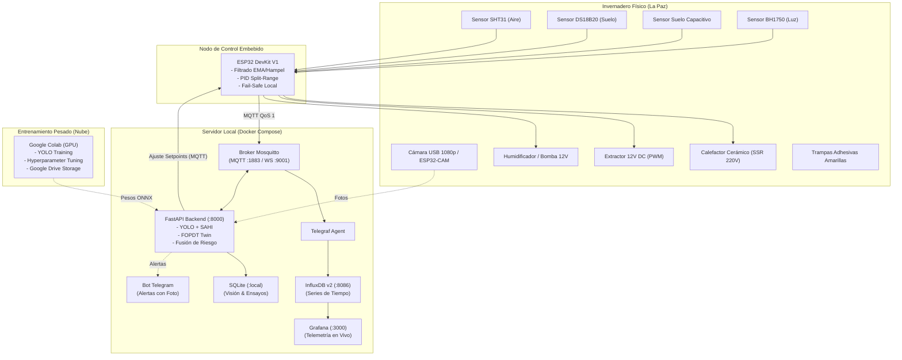

# Prototipo Integrado IoT–PID–IA para Papa bajo Invernadero (La Paz, Bolivia)

[](https://opensource.org/licenses/MIT)
[](https://www.python.org/downloads/)
[](https://docs.docker.com/compose/)
[](https://platformio.org/)

Repositorio oficial del proyecto de grado / tesis:  
**"Prototipo de Sistema Integrado IoT–PID–Inteligencia Artificial para la Regulación Microclimática y Detección Temprana de Plagas en el Cultivo de Papa bajo Invernadero"**  
*Contexto agronómico y geográfico:* Departamento de La Paz, Bolivia (altitud ~3600 msnm, clima frío nocturno, alta amplitud térmica y radiación solar diurna).

---

## 1. Arquitectura General del Sistema

El sistema implementa una arquitectura en cascada desacoplada:
1. **Lazo Rápido Local (ESP32):** Ejecuta control PID continuo a 10 Hz para temperatura y humedad con modulación por ancho de pulso proporcional a tiempo (SSR) y PWM (extractores). Si se interrumpe la red o el servidor central, el nodo sigue operando en modo autónomo.
2. **Lazo de Supervisión (Servidor IoT / Docker):** Ingesta datos mediante Mosquitto y Telegraf hacia InfluxDB v2, permitiendo visualización en Grafana. Un servicio FastAPI orquesta la inferencia de visión (YOLO + SAHI) y el modelo de riesgo fitopatológico (BlightManager + ML), ajustando los setpoints del lazo rápido por MQTT.



---

## 2. Estructura de Directorios del Repositorio

```
IOTtesis/
├── config/                         # Configuraciones declarativas de servicios
│   ├── mosquitto/                  # Configuración de Eclipse Mosquitto
│   ├── telegraf/                   # Mapeo MQTT a InfluxDB v2
│   └── grafana/                    # Aprovisionamiento automático de datasources/dashboards
├── data/                           # Almacenamiento local de datos
│   ├── raw/                        # Imágenes sin procesar (ignoradas en git)
│   ├── processed/                  # Datasets preparados (ignorados en git)
│   ├── synthetic/                  # Datos de simulación para pruebas
│   ├── models/                     # Pesos exportados (.onnx, .pt)
│   └── invernadero_relacional.db   # Base de datos relacional SQLite
├── docs/                           # Documentación técnica y metodológica
│   ├── especificacion_iot_protocolos.md
│   ├── prompt_maestro_tesis_iot_pid_ia_papa.md
│   ├── algoritmos_prototipo_iot_pid_ia_papa.md
│   └── hardware_prototipo_iot_pid_ia_papa.md
├── experiments/                    # Protocolos y registros de experimentos E1 a E8
│   ├── e1_deteccion/               # Comparativa de arquitecturas YOLO
│   ├── e2_trampas/                 # Evaluación de SAHI sobre trampas amarillas
│   ├── e3_clasificacion/           # Clasificación de patologías foliares
│   ├── e4_control_temperatura/     # Ensayos On/Off vs PID
│   ├── e5_control_humedad/         # Ensayos de balance psicrométrico
│   ├── e6_prediccion_riesgo/       # Validación de BlightManager vs ML
│   ├── e7_sistema_completo/        # Ensayos testigo con vs sin sistema
│   └── e8_robustez/                # Pruebas de corte eléctrico e incomunicación
├── firmware/                       # Código fuente embebido
│   ├── esp32_control/              # Proyecto PlatformIO para ESP32
│   └── wokwi/                      # Configuración de simulación en Wokwi
├── notebooks/                      # Cuadernos Jupyter para Google Colab
├── scripts/                        # Utilidades y simuladores
│   ├── init_db.py                  # Creación de tablas SQLite
│   └── simulador_esp32_mqtt.py     # Simulador FOPDT de microclima y PID
├── server/                         # Backend FastAPI y workers
├── thesis/                         # Memoria de grado y capítulos
├── web/                            # Frontend interactivo para defensa
├── .env.example                    # Plantilla de variables de entorno
├── .gitignore                      # Reglas de exclusión para Git
├── docker-compose.yml              # Pila de contenedores base
└── requirements.txt                # Dependencias de Python con versiones fijadas
```

---

## 3. Puesta en Marcha Rápida (Entorno de Desarrollo)

### Prerrequisitos
- Docker Engine 24+ y Docker Compose v2+
- Python 3.10+
- Acceso a internet para descarga de imágenes de Docker

### Paso 1: Configurar Variables de Entorno
```bash
cp .env.example .env
```

### Paso 2: Levantar la Infraestructura IoT con Docker Compose
```bash
docker compose up -d
```
Verifica que los cuatro contenedores estén saludables:
```bash
docker compose ps
```
- **Broker MQTT Mosquitto:** `localhost:1883` (WebSockets en `9001`)
- **InfluxDB v2:** `http://localhost:8086`
- **Grafana:** `http://localhost:3000` (Usuario: `admin`, Clave: `admin_tesis_grafana`)

### Paso 3: Inicializar la Base de Datos Relacional SQLite
```bash
python3 scripts/init_db.py
```

### Paso 4: Iniciar el Simulador de Pruebas FOPDT
Para verificar el flujo completo de telemetría y control sin necesidad de conectar el ESP32 físico:
```bash
python3 scripts/simulador_esp32_mqtt.py
```

---

## 4. Tópicos MQTT y Esquemas de Datos

Consulta la especificación técnica completa en [`docs/especificacion_iot_protocolos.md`](file:///home/rodrigo/Desktop/IOTtesis/docs/especificacion_iot_protocolos.md).

Principales canales:
- `invernadero/telemetria/microclima`: Temperatura, Humedad, Suelo, Luz, CO2, VPD, Punto de Rocío.
- `invernadero/telemetria/pid`: Setpoint, Variable de Proceso, Señal de Control (%), Salidas PWM.
- `invernadero/control/setpoint`: Comandos de ajuste remoto desde lazo IA o panel web.
- `invernadero/vision/deteccion`: Conteo e inferencia de insectos en trampas amarillas (YOLO+SAHI).
- `invernadero/alerta`: Eventos críticos canalizados al bot de Telegram.

---

## 5. Licencia y Cita Académica

Este proyecto se distribuye bajo la licencia **MIT** para fines académicos y de investigación.  
Para citar este trabajo o hacer referencia a los algoritmos y metodología, remitirse a la memoria formal de tesis disponible en el directorio [`thesis/`](file:///home/rodrigo/Desktop/IOTtesis/thesis/).
