# Diagrama de Conexiones Físicas y Esquema de Hardware del ESP32

> **Proyecto:** Tesis IoT-PID-IA Papa bajo Invernadero (La Paz, Bolivia)  
> **Fase:** 1 – Hardware y Firmware del ESP32

---

## 1. Diagrama Esquemático del Circuito de Hardware

```mermaid
graph TD
    subgraph Alimentacion ["Etapa de Alimentación y Fuentes"]
        RED["Red 220V AC (La Paz)"]
        F12["Fuente Switching 12V 10A DC"]
        BUCK["Buck LM2596 (12V -> 5V DC)"]
        FUS["Fusibles de Protección (5A / 8A)"]
        RED --> FUS --> F12
        F12 --> BUCK
    end

    subgraph ESP32_Board ["Placa de Control ESP32 DevKit V1 (30 pines)"]
        VIN["Pin VIN (5V DC)"]
        GND["GND Común"]
        P3V3["Pin 3V3 (Sensores)"]
        
        G21["GPIO 21 (SDA)"]
        G22["GPIO 22 (SCL)"]
        G4["GPIO 4 (OneWire)"]
        G34["GPIO 34 (ADC1_CH6)"]
        G35["GPIO 35 (Digital IN)"]
        
        G23["GPIO 23 (Digital OUT)"]
        G19["GPIO 19 (LEDC PWM)"]
        G18["GPIO 18 (Active-LOW)"]
        G26["GPIO 26 (Active-LOW)"]
        G2["GPIO 2 (LED Onboard)"]
    end

    subgraph Sensores ["Instrumentación y Sensores"]
        SHT["SHT31 (Aire: T / HR)<br/>Dirección: 0x44"]
        DS["DS18B20 (Suelo: Temp)<br/>R_pullup 4.7kΩ"]
        CAP["Sensor Capacitivo v1.2<br/>(Humedad Suelo)"]
        BH["BH1750 (Luz Lux)<br/>Dirección: 0x23"]
        BOYA["Boya Nivel Agua<br/>R_pullup 10kΩ"]
    end

    subgraph Potencia ["Etapa de Potencia y Aislamiento Galvánico"]
        SSR["Relé Estado Sólido Fototriac<br/>(Fotek SSR-25DA 220V)"]
        MOSFET["Módulo MOSFET IRLZ44N<br/>(Gate R=100Ω + Pulldown 10kΩ)"]
        RELE1["Módulo Relé Optoacoplado CH1"]
        RELE2["Módulo Relé Optoacoplado CH2"]
    end

    subgraph Actuadores ["Actuadores Físicos"]
        CAL["Calefactor Cerámico 220V AC"]
        EXT["Extractor 12V DC (PWM 25 kHz)"]
        HUM["Humidificador 24V / 220V"]
        BOMBA["Bomba Riego 12V DC<br/>(Diodo Flyback 1N4007)"]
    end

    BUCK --> VIN
    F12 --> MOSFET & RELE1 & RELE2
    RED --> SSR --> CAL

    P3V3 --> SHT & DS & CAP & BH & BOYA
    GND --- BUCK & F12 & MOSFET & SSR & RELE1 & RELE2

    G21 & G22 --> SHT & BH
    G4 --> DS
    G34 --> CAP
    G35 --> BOYA

    G23 -- "Time-PWM (2.0 s)" --> SSR
    G19 -- "PWM 25 kHz" --> MOSFET --> EXT
    G18 --> RELE1 --> HUM
    G26 --> RELE2 --> BOMBA
```

---

## 2. Tabla Maestra de Asignación de Pines (ESP32 DevKit V1 30 Pines)

| GPIO ESP32 | Función Asignada | Tipo Señal | Nivel Lógico | Circuito Auxiliar / Protección |
| :---: | :--- | :--- | :---: | :--- |
| **GPIO 21** | I2C SDA (SHT31 + BH1750) | Bidireccional | 3.3 V | Bus compartido; pull-up 4.7 kΩ a 3.3 V. |
| **GPIO 22** | I2C SCL (SHT31 + BH1750) | Salida (Reloj) | 3.3 V | Bus compartido; pull-up 4.7 kΩ a 3.3 V. |
| **GPIO 4** | 1-Wire Bus (DS18B20 Suelo) | Bidireccional | 3.3 V | Resistencia pull-up externa de 4.7 kΩ entre datos y 3.3 V. |
| **GPIO 34** | Analógico Humedad Suelo | Entrada ADC | 0 a 3.3 V | Pertenece a **ADC1 (Canal 6)**. Seguro con WiFi activo. |
| **GPIO 35** | Flotador Nivel Tanque | Entrada Digital | 3.3 V | Pin solo entrada (GPI). Pull-up externa de 10 kΩ a 3.3 V. |
| **GPIO 23** | Calefactor 220 V (SSR) | Salida Digital | 3.3 V | Modulación lenta por ventana de 2000 ms hacia SSR Fototriac. |
| **GPIO 19** | Extractor 12 V (MOSFET) | Salida PWM | 3.3 V | Frecuencia 25 kHz. Resistencia en gate 100 Ω + pulldown 10 kΩ. |
| **GPIO 18** | Humidificador (Relé CH1) | Salida Digital | 3.3 V | Lógica negativa (*Active-LOW*). Optoacoplador integrado. |
| **GPIO 26** | Bomba Riego (Relé CH2) | Salida Digital | 3.3 V | Lógica negativa (*Active-LOW*). Diodo flyback 1N4007 en bomba. |
| **GPIO 2** | LED Diagnóstico / Heartbeat | Salida Digital | 3.3 V | LED azul integrado en placa. Parpadea a 1 Hz en operación normal. |

---

## 3. Comparativa: PlatformIO (C++) vs ESPHome

| Criterio | Firmware PlatformIO en C++ ⭐ | Alternativa ESPHome (YAML) |
| :--- | :--- | :--- |
| **Control del Algoritmo PID** | **Total:** Implementación directa con anti-windup por integración condicional, derivada sobre la medición y split-range milimétrico. | **Limitado:** Usa el componente `climate.pid`, que es más rígido para personalizar transiciones o algoritmos de autotune de relé. |
| **Filtrado de Sensores** | Algoritmo Hampel para rechazo de picos atípicos + filtro de media móvil exponencial (EMA) a medida. | Filtros predefinidos (EMA o median), pero sin lógica Hampel condicional compleja. |
| **Cálculos Locales en Borde** | Ecuaciones psicrométricas de alta precisión calculadas en el microcontrolador (VPD y punto de rocío). | Requiere sensores plantilla (*template sensors*) mediante expresiones lambda en C++. |
| **Autonomía ante Caídas de Red** | Modo seguro autónomo nativo con fallback inmediato y refresco de Hardware Watchdog directo (`esp_task_wdt`). | Requiere configuración de fallback AP y lógica manual en YAML. |
| **Tiempo de Compilación / Modificación** | Rápido y ligero con PlatformIO Core. | Genera código C++ intermedio y compila todo el ecosistema; más lento en máquinas modestas. |
| **Veredicto para la Tesis** | **Recomendado para la defensa:** Demuestra competencia en sistemas embebidos, teoría de control y C++ en tiempo real. | Excelente como plan B rápido o para reproducir el hardware en minutos. |

---

## 4. Archivos JSON Creados

1. [circuito_esp32_invernadero.json](file:///home/rodrigo/Desktop/IOTtesis/diagramas/circuito_esp32_invernadero.json): Especificación completa del circuito, voltajes, protecciones galvánicas y buses.
2. [wokwi_diagram.json](file:///home/rodrigo/Desktop/IOTtesis/diagramas/wokwi_diagram.json): Diagrama esquemático interactivo listo para abrir y simular en Wokwi.
