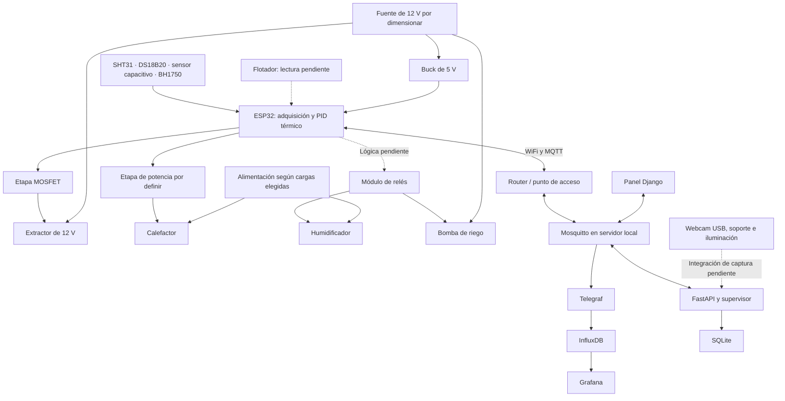

# Hardware e infraestructura del prototipo IoT–PID–IA para papa bajo invernadero

**Proyecto:** Prototipo de Sistema Integrado IoT–PID–Inteligencia Artificial para la Regulación Microclimática y Detección Temprana de Plagas en el Cultivo de Papa bajo Invernadero.

**Ubicación del proyecto:** La Paz, Bolivia.  
**Fecha de elaboración:** 6 de noviembre de 2026.  
**Alcance:** componentes, infraestructura física y de software, conexiones, alimentación, montaje, presupuesto y validación para el apartado de hardware de tesis.

Este README reúne la información disponible en el repositorio y la lista de componentes organizada en la conversación. Las cantidades iniciales corresponden a una propuesta de una zona de control. La existencia de código o de una simulación no confirma que el equipo esté comprado, ensamblado o validado físicamente. Los datos pendientes se identifican mediante `[FALTA: dato]`.

## 1. Resumen general y bloques del sistema

El sistema contempla la adquisición de temperatura y humedad del aire, temperatura y humedad del suelo e iluminancia. Un ESP32 procesa las mediciones y ejecuta el control local de temperatura mediante calefacción y extracción. El diseño también incluye humidificación y riego, cuya lógica de accionamiento debe completarse en el firmware revisado.

El ESP32 intercambia telemetría y comandos con un servidor mediante WiFi y MQTT. El servidor aloja almacenamiento, visualización y procesamiento de imágenes para la supervisión del cultivo. Una cámara captura imágenes de hojas o trampas adhesivas.

| Bloque | Elementos principales | Función |
|---|---|---|
| Control local | ESP32 DevKit V1 | Adquisición, filtrado, PID térmico y comunicación. |
| Instrumentación | SHT31, DS18B20, sensor capacitivo, BH1750 y flotador | Medición del ambiente, sustrato y nivel del tanque. |
| Actuación | Extractor, calefactor, humidificador y bomba | Modificación del microclima y suministro de agua. |
| Potencia y alimentación | MOSFET, relés, etapa del calefactor, fuentes y buck | Adaptación de las señales del ESP32 a las cargas. |
| Visión | Cámara, soporte e iluminación | Captura de imágenes reproducibles. |
| Supervisión | Computadora, red y servicios de software | Registro, consulta, inferencia y envío de consignas. |
| Infraestructura física | Invernadero, cultivo, tanque y caja de electrónica | Soporte físico del prototipo. |

## 2. Componentes necesarios

### 2.1. Control e instrumentación para una zona inicial

| Componente | Modelo o especificación documental | Cantidad inicial | Función |
|---|---|---:|---|
| Microcontrolador | ESP32 DevKit V1; confirmar variante de placa | 1 | Ejecutar el firmware y conectar el nodo a la red. |
| Placa de terminales | Compatible con el ESP32 adquirido | 1 | Asegurar las conexiones. |
| Sensor de aire | SHT31 | 1 | Medir temperatura y humedad relativa. |
| Sensor de temperatura del suelo | DS18B20 sumergible | 1 | Medir temperatura edáfica. |
| Sensor de humedad del suelo | Capacitivo v1.2 | 1 | Adquirir una señal analógica del sustrato. |
| Luxómetro | BH1750 | 1 | Medir iluminancia en lux. |
| Sensor de nivel | Flotador | 1 | Detectar nivel de agua; falta implementar su lectura y enclavamiento. |
| Resistencia OneWire | 4,7 kΩ | 1 | Pull-up entre datos del DS18B20 y 3,3 V. |
| Resistencia del flotador | 10 kΩ | 1 | Pull-up externa de la entrada de nivel. |
| Pull-ups I2C | 4,7 kΩ, según el documento de conexiones | Según módulos | Confirmar las resistencias ya presentes en las placas. |
| Cable USB de datos | Compatible con el conector de la placa | 1 | Programación y diagnóstico. |

El firmware utiliza un SHT31 en `0x44`, un DS18B20 mediante el índice 0 y una entrada analógica de suelo. La propuesta ampliada del documento original contempla dos SHT31, dos DS18B20 y tres o cuatro sensores capacitivos. Añadir esas unidades requiere actualizar el cableado, direccionamiento, lectura y telemetría. La lista económica original menciona dos sensores capacitivos; la cantidad de uno de esta tabla se limita a la entrada actualmente definida.

### 2.2. Actuadores y etapas de potencia

| Componente | Cantidad inicial | Función | Pendiente de selección |
|---|---:|---|---|
| Extractor o ventilador de 12 V DC | 1 | Extracción y enfriamiento. | [FALTA: modelo, corriente, caudal y forma de control PWM compatible] |
| Módulo MOSFET para extractor | 1 | Conmutación PWM del ventilador. | [FALTA: confirmar funcionamiento con señal de 3,3 V y corriente de la carga] |
| Calefactor | 1 | Elevar la temperatura. | [FALTA: decidir entre la opción DC y la opción AC, y definir potencia] |
| Etapa de potencia del calefactor | 1 | Conmutación proporcional en el tiempo. | [FALTA: dispositivo compatible con la carga y con la señal de control] |
| Humidificador o nebulizador | 1 | Elevar la humedad relativa. | [FALTA: modelo, tensión y consumo] |
| Bomba de agua de 12 V DC | 1 | Suministrar agua al riego. | [FALTA: corriente, caudal y altura requerida] |
| Módulo de relés | 1 de cuatro canales | Conmutar bomba y humidificador. | [FALTA: compatibilidad de entrada con el ESP32 y capacidad de contactos] |
| Electroválvula de 12 V | Según circuito hidráulico | Controlar pasos de agua o zonas. | La propuesta original indica una o dos; falta confirmar necesidad. |

El documento original propone dos extractores y dos módulos MOSFET. Para una zona inicial se considera una salida de extracción, como la definida en el firmware.

**Decisión pendiente sobre calefacción:** la lista original propone un PTC de 12/24 V, mientras que el documento de conexiones representa un calefactor de 220 V AC con SSR-25DA. Estas opciones no están unificadas. La referencia de SSR de 25 A del diseño no constituye un dimensionamiento validado. Debe seleccionarse la etapa de potencia para la tensión, corriente y tipo de carga finalmente elegidos.

### 2.3. Alimentación y material eléctrico

| Elemento | Cantidad de partida | Observación |
|---|---:|---|
| Fuente de 12 V DC | 1 | La propuesta ampliada indica 10 A y la económica 5 A; falta dimensionar. |
| Convertidor buck de 12 V a 5 V | 1 para el montaje inicial | Se proponen LM2596 o XL4015; la lista ampliada incluye dos. |
| Fuente adicional para cargas de otra tensión | Según selección | [FALTA: alimentación del humidificador de 24 V si se adopta esa opción] |
| Fusibles y portafusibles | Según ramas | [FALTA: valores y ubicación definitivos] |
| Protección de cargas inductivas | Según cargas | El documento propone diodos 1N4007; falta confirmar adecuación a cada carga. |
| Resistencias para etapa MOSFET | Según módulo | El esquema menciona 100 Ω en gate y 10 kΩ de pulldown. |
| Borneras, cables y terminales | Un lote | El documento menciona AWG 18/22; falta dimensionar por corriente y longitud. |
| Caja estanca con prensaestopas | 1 | Grado IP65 propuesto. |
| Base o placa perforada, separadores y fijaciones | Un conjunto | Montaje de electrónica. |

### 2.4. Cámara y captura

| Elemento | Cantidad inicial | Función |
|---|---:|---|
| Webcam USB 1080p con autofocus | 1 | Opción principal propuesta para captura. [FALTA: modelo final] |
| Soporte rígido o articulado | 1 | Mantener el encuadre y la distancia. |
| Iluminación LED difusa | Un conjunto | Disminuir variaciones de iluminación y reflejos. |
| Trampas adhesivas amarillas o azules | Según ensayo | Disponer de objetivos para fotografiar insectos. |

ESP32-CAM AI Thinker con OV2640 y ESP32-S3-CAM con OV5640 aparecen como alternativas o ampliaciones. No se necesita adquirir ambas opciones para comenzar con una webcam USB. La conexión automática de la cámara al proceso de captura e inferencia queda [FALTA: implementar o confirmar].

## 3. Especificaciones técnicas disponibles

| Elemento | Parámetros documentados | Datos pendientes |
|---|---|---|
| ESP32 DevKit V1 | Lógica de 3,3 V; WiFi de 2,4 GHz; entorno PlatformIO `esp32dev` con Arduino. | [FALTA: variante exacta, memoria, frecuencia de CPU, dimensiones y consumo de la placa adquirida] |
| SHT31 | I2C, dirección `0x44`. El documento original indica ±0,3 °C y ±2 % HR. | [FALTA: ficha técnica del módulo real, condiciones de precisión, rango, corriente y dimensiones] |
| DS18B20 | OneWire; alimentación a 3,3 V representada en el esquema; pull-up de 4,7 kΩ. | [FALTA: resolución configurada, tiempo de conversión efectivo y características de la sonda adquirida] |
| Sensor capacitivo | GPIO 34, ADC1_CH6; calibración de firmware: 3100 en aire seco y 1450 en saturación. | [FALTA: tensión máxima real de salida, consumo y calibración experimental] |
| BH1750 | I2C; dirección `0x23` en el esquema; modo de alta resolución continua en firmware. | [FALTA: ficha técnica del módulo, rango, error y consumo] |
| Extractor | Alimentación propuesta de 12 V; salida de control configurada a 25 kHz y ocho bits. | [FALTA: verificar que el extractor y su etapa admitan ese control] |
| Calefactor | Control temporal configurado con ventana de 2000 ms. | [FALTA: tensión, potencia, corriente y dimensiones] |
| Bomba y humidificador | Relés de control activos en bajo. | [FALTA: modelos y especificaciones de las cargas] |
| Fuente | Propuesta de 12 V y 10 A en la lista ampliada. | [FALTA: modelo, capacidad elegida y eficiencia] |

La temporización configurada en el programa es de 100 ms para adquisición/PID y 1000 ms para publicación de telemetría, con watchdog de 10 s. Estos son valores de configuración; no acreditan la frecuencia efectiva del lazo bajo las lecturas y comunicaciones reales. [FALTA: medir tiempos de ejecución].

La salida PID térmica se distribuye entre calefacción y extracción. El código acepta una consigna de humedad, pero no implementa un segundo PID de humedad ni la actuación automática de humidificador y bomba en el archivo revisado.

## 4. Justificación de selección y alternativas

| Selección propuesta | Justificación recogida del proyecto | Alternativa documentada |
|---|---|---|
| ESP32 | Integra conectividad WiFi y permite sensado y control local. | Arduino Mega 2560 con ESP-01/ESP8266, con mayor cantidad de módulos. |
| SHT31 | El documento lo prioriza por precisión frente al DHT22. | DHT22/AM2302 para comparación o variante económica. |
| Sensor capacitivo | El documento lo prioriza para reducir problemas de corrosión respecto a sensores resistivos. | YL-69 resistivo, descartado en la propuesta. |
| DS18B20 sumergible | Medición de temperatura del suelo con sonda y bus OneWire. | [FALTA: alternativas evaluadas] |
| BH1750 | Medición de iluminancia por I2C. | [FALTA: alternativas evaluadas] |
| MOSFET | Control PWM de una carga DC. | Se mencionan varias referencias en el documento, sin validación de compatibilidad. |
| SSR para la opción AC | Modulación temporal sin conmutación mecánica repetitiva. | [FALTA: selección y comparación para la carga final] |
| Webcam USB | El documento la propone como cámara principal para dataset y pruebas. | ESP32-CAM, ESP32-S3-CAM y cámara USB macro. |

Estas justificaciones corresponden al diseño propuesto. [FALTA: registrar criterios cuantitativos de selección, disponibilidad, fichas técnicas y decisión final de compra].

## 5. Diagrama de bloques

Este diagrama describe bloques funcionales y sus relaciones. No sustituye el esquema eléctrico definitivo ni detalla el cableado de potencia.

## 6. Conexiones y pines

| Origen | Destino | Señal o protocolo | Consideración documental |
|---|---|---|---|
| GPIO 21 | SDA de SHT31 y BH1750 | I2C | Pull-ups a 3,3 V; confirmar las integradas en módulos. |
| GPIO 22 | SCL de SHT31 y BH1750 | I2C | Bus compartido. |
| GPIO 4 | DQ de DS18B20 | OneWire | Pull-up externa de 4,7 kΩ a 3,3 V. |
| Salida del sensor capacitivo | GPIO 34 | Analógica, ADC1_CH6 | [FALTA: verificar tensión máxima de la salida] |
| Contacto del flotador | GPIO 35 | Entrada digital | Pull-up externa de 10 kΩ a 3,3 V prevista. |
| GPIO 23 | Entrada de control de etapa del calefactor | Digital, modulación temporal | Ventana configurada de 2 s. |
| GPIO 19 | Entrada de control del módulo MOSFET | PWM LEDC | 25 kHz, ocho bits, canal 0. |
| GPIO 18 | Entrada del relé del humidificador | Digital activa en bajo | Inicializada en apagado. |
| GPIO 26 | Entrada del relé de la bomba | Digital activa en bajo | Inicializada en apagado. |
| GPIO 2 | LED integrado | Digital | Cambio de estado cada 500 ms en el programa. |
| Salida de 5 V del buck | VIN del ESP32, según esquema | Alimentación | [FALTA: confirmar terminal según variante de placa] |
| 3V3 del ESP32 | Alimentación de sensores, según esquema | Alimentación | [FALTA: comprobar módulos y balance de corriente] |
| GND del circuito de baja tensión | Referencias de sensores y etapas correspondientes | Referencia eléctrica | [FALTA: esquema final de tierras y aislamiento] |

La tabla recoge GPIO, no números de posición física de un conector. Debe cotejarse con la placa adquirida. El encabezado de configuración especifica DevKit V1 de 30 pines, mientras que la lista original admite 30 o 38 y Wokwi representa otra placa.

## 7. Alimentación, protecciones y consumo

La alimentación propuesta parte de una fuente de 12 V para cargas DC y un convertidor reductor a 5 V para el controlador. El esquema representa sensores alimentados desde 3,3 V. Si se adopta el humidificador de 24 V, debe resolverse su alimentación específica; el buck de 12 V a 5 V no proporciona esa tensión.

No se dispone de corrientes nominales, corrientes de arranque ni ciclos de funcionamiento de los actuadores. Por ello, no se confirma la suficiencia de la fuente de 12 V y 10 A ni se presenta un consumo total como resultado medido.

Para completar el cálculo se debe sumar la demanda simultánea de cada rama, incluir la entrada de los convertidores con sus pérdidas y considerar los arranques de las cargas. [FALTA: tabla de tensión, corriente nominal, corriente de arranque y simultaneidad por carga].

El diseño contempla fusibles, protección de cargas inductivas, borneras, caja IP65 y prensaestopas. El documento de conexiones menciona fusibles de 5 A y 8 A sin dimensionamiento final por rama. [FALTA: seleccionar valores, cableado, disipación y protecciones a partir de las cargas reales].

Para la variante con red AC, la documentación exige caja cerrada y aislamiento de las conexiones. El circuito de potencia de esa variante debe definirse antes del ensamblaje.

## 8. Infraestructura física, de red y de software

### 8.1. Invernadero y sistema hidráulico

| Elemento | Propuesta disponible | Pendiente |
|---|---|---|
| Invernadero a escala | Aproximadamente 1 × 1,5 × 1,5 m; estructura de PVC, madera o metal con agrofilm. | [FALTA: dimensiones y material definitivos] |
| Cultivo | Macetas o cajones para 6–12 plantas. | [FALTA: cantidad, variedad, distribución, sustrato y semilla] |
| Tanque | Capacidad propuesta de 20–50 L. | [FALTA: capacidad final y ubicación] |
| Riego | Bomba, mangueras y goteros; electroválvulas según circuito. | [FALTA: trazado hidráulico, caudal y número de zonas] |
| Sensor de aire | Pantalla de radiación o caja ventilada. | [FALTA: altura y ubicación de montaje] |
| Electrónica | Caja estanca con prensaestopas. | [FALTA: distribución y ubicación física] |
| Captura | Cámara fija, soporte e iluminación difusa. | [FALTA: geometría definitiva y capturas de prueba] |

### 8.2. Computadora y conectividad

| Recurso | Referencia propuesta en el proyecto |
|---|---|
| Computadora local | Intel i5/Ryzen 5 de cuatro núcleos, 8 GB de RAM y SSD de 256 GB como referencia inicial. |
| Variante ampliada | i7/Ryzen 7, 16 GB de RAM y SSD de 512 GB. |
| Sistema operativo | Ubuntu con Docker o Windows con Docker, según el documento original. |
| Red | Router o punto de acceso WiFi de 2,4 GHz con cobertura hasta el invernadero. |
| Internet | Acceso para descargar dependencias y para las funciones de Colab o Telegram que se utilicen. |
| Respaldo eléctrico | UPS opcional para el equipo servidor. |

Estos valores de computadora son referencias de planificación, no requisitos validados por una medición de carga. [FALTA: inventario del equipo disponible, rendimiento de inferencia y capacidad de almacenamiento requerida]. El diseño contempla entrenamiento en Colab; no establece como obligatoria una GPU local.

### 8.3. Servicios del servidor

La configuración de Docker Compose contiene seis servicios. Pueden alojarse en una computadora, sujeto a verificar sus recursos:

| Servicio o aplicación | Función | Configuración relevante |
|---|---|---|
| Mosquitto | Broker MQTT. | Puertos publicados 1883 y 9001. |
| Telegraf | Ingesta de telemetría hacia InfluxDB. | Servicio en la red de Compose. |
| InfluxDB | Almacenamiento de series temporales. | Puerto publicado 8086. |
| Grafana | Tableros de telemetría. | Puerto del host 3001 por defecto en Compose, configurable con `GRAFANA_PORT`. |
| FastAPI | API y procesamiento del backend. | Puerto publicado 8000. |
| Worker | Supervisión y fusión de información. | Servicio independiente dentro de Compose. |
| SQLite | Datos relacionales. | Archivo local compartido; no es otro servidor. |
| Django | Panel operativo del proyecto. | Existe en `web/`; no figura como servicio en este Compose. |

La asignación física de la cámara a un proceso de captura y, si corresponde, su acceso desde contenedores están [FALTA: confirmar]. No se acredita aquí un despliegue operativo completo.

### 8.4. Protocolos y configuración

| Comunicación | Configuración documentada |
|---|---|
| SHT31 y BH1750 ↔ ESP32 | I2C en GPIO 21/22; frecuencia de bus [FALTA: documentar]. |
| DS18B20 ↔ ESP32 | OneWire en GPIO 4. |
| Sensor capacitivo → ESP32 | ADC en GPIO 34; calibración pendiente de medición. |
| Flotador → ESP32 | Entrada digital GPIO 35; lectura pendiente. |
| ESP32 → extractor | PWM de 25 kHz y ocho bits. |
| ESP32 → calefactor | Modulación temporal de 2 s. |
| ESP32 ↔ red local | WiFi en modo estación. |
| ESP32 ↔ broker | MQTT por TCP, puerto 1883; IP del broker configurable en firmware. |
| Diagnóstico | Puerto serie a 115200 baudios. |

El firmware publica en `invernadero/telemetria/microclima` e `invernadero/telemetria/pid`; recibe comandos en `invernadero/control/setpoint`, `invernadero/control/ganancias` e `invernadero/control/modo`. Los mensajes utilizan JSON.

La especificación documental incluye QoS y retención por tópico, pero su presencia en el documento no acredita que todas las opciones estén implementadas en el cliente ESP32. Además, Compose configura clientes autenticados y el firmware revisado intenta conectarse con su identificador, sin proporcionar usuario y contraseña. [FALTA: unificar autenticación y contratos de mensajes, y comprobar comunicación extremo a extremo]. Las credenciales no se reproducen en este README.

## 9. Montaje y ensamblaje

Secuencia propuesta; [FALTA: confirmar ejecución y registrar fotografías del montaje]:

1. Definir dimensiones del invernadero, distribución del cultivo, ubicación del tanque y rutas del cableado.
2. Seleccionar modelos de actuadores y completar el dimensionamiento de fuentes, etapas de potencia, cables y protecciones.
3. Montar el controlador y preparar las alimentaciones reguladas. Medir tensión y polaridad antes de conectar la placa.
4. Conectar los sensores según la tabla de GPIO y verificar sus alimentaciones y resistencias auxiliares.
5. Comprobar por separado la lectura de cada sensor y realizar las calibraciones necesarias.
6. Cablear las entradas de control de las etapas de potencia y verificar sus estados de arranque antes de conectar las cargas.
7. Conectar actuadores por ramas protegidas y comprobar cada uno individualmente.
8. Instalar electrónica, borneras y entradas de cable en la caja prevista.
9. Montar el sistema hidráulico, flotador, cámara, soporte e iluminación.
10. Configurar la red y el servidor, unificar los mensajes MQTT y ejecutar ensayos documentados del conjunto.

Herramientas y consumibles previstos: multímetro, soldador y estaño, protoboard para pruebas, placa perforada, cables de datos, terminales, pinzas, destornilladores, termocontraíble, cinta aislante y bridas. Para validar el aire se propone un termohigrómetro de referencia. [FALTA: identificación y características de los instrumentos disponibles].

## 10. Pruebas y validación

Esta sección organiza pruebas pendientes de evidencia. No informa ensayos físicos como ejecutados. Los archivos Wokwi representan algunas señales mediante LEDs y la humedad del suelo mediante un potenciómetro; no prueban actuadores ni consumos reales.

| Módulo | Prueba a documentar | Evidencia pendiente |
|---|---|---|
| Alimentación | Medir tensiones sin carga, bajo carga y durante arranques. | [FALTA: tensiones, corrientes, caídas y estabilidad] |
| SHT31 | Comparar con referencia en condiciones registradas. | [FALTA: muestras, error, repetibilidad y criterio de aceptación] |
| DS18B20 | Comparar temperatura con una referencia. | [FALTA: resultados y condiciones de la prueba] |
| Humedad de suelo | Obtener puntos de calibración con el sustrato utilizado. | [FALTA: procedimiento, curva y error; no atribuir humedad volumétrica sin validación] |
| BH1750 | Verificar lecturas y comparar con referencia si está disponible. | [FALTA: resultados y condiciones de iluminación] |
| Flotador | Simular tanque con y sin agua y verificar el bloqueo de bomba. | [FALTA: implementar lógica y registrar resultado] |
| Extractor | Verificar respuesta a distintos ciclos de trabajo. | [FALTA: corriente, arranque y respuesta al PWM] |
| Calefactor | Verificar conmutación, respuesta térmica y disipación de la etapa. | [FALTA: selección definitiva y mediciones] |
| Humidificador y riego | Comprobar mando, funcionamiento y respuesta del proceso. | [FALTA: lógica, caudal y resultados] |
| PID térmico | Registrar consigna, temperatura y salida ante cambios y perturbaciones. | [FALTA: resultados del prototipo y temporización efectiva] |
| WiFi/MQTT | Comprobar datos, comandos, reconexión y continuidad local sin red. | [FALTA: registros y comportamiento ante fallos] |
| Cámara e inferencia | Comprobar enfoque, tamaño de los objetivos, captura y procesamiento. | [FALTA: muestras reales, integración y tiempos] |
| Integración | Ejecutar ensayo continuo con el conjunto conectado. | [FALTA: duración, incidencias y criterios de aceptación] |

Los parámetros de simulación o resultados de entrenamiento del software no sustituyen la validación del hardware físico.

## 11. Presupuesto y BOM

Los precios siguientes se transcriben de la propuesta de hardware del repositorio. Son rangos históricos de planificación en USD, sin cotización actual, envío ni impuestos confirmados. No se han consultado proveedores para este README.

### 11.1. Partidas con precio documental

| Componente | Cantidad inicial | Precio unitario documental (USD) | Subtotal inicial (USD) |
|---|---:|---:|---:|
| ESP32 DevKit V1 | 1 | 6–10 | 6–10 |
| Placa de terminales | 1 | 4–6 | 4–6 |
| SHT31 | 1 | 5–10 | 5–10 |
| DS18B20 | 1 | 3–4 | 3–4 |
| Sensor capacitivo v1.2 | 1 | 2–3 | 2–3 |
| BH1750 | 1 | 2–3 | 2–3 |
| Flotador | 1 | 2–4 | 2–4 |
| Pantalla de radiación/caja ventilada | 1 | 3–5 | 3–5 |
| Webcam USB 1080p | 1 | 30–60 | 30–60 |
| **Subtotal parcial** | | | **57–105** |

Este subtotal solo suma las filas anteriores. Faltan actuadores, fuentes, etapas de potencia, material de montaje, estructura y otros elementos; no representa el costo del sistema completo.

### 11.2. Partidas sin cotización individual

| Partida | Cantidad | Costo |
|---|---|---|
| Extractor, bomba, calefactor y humidificador | Uno de cada uno como propuesta inicial | [FALTA: precios según modelos] |
| MOSFET, relés y etapa de calefacción | Según tabla de componentes | [FALTA: precios de módulos compatibles] |
| Fuentes, buck y protecciones | Según dimensionamiento | [FALTA: precios y cantidades finales] |
| Soporte de cámara, iluminación y trampas | Según ensayo | [FALTA: cotización] |
| Caja, cables, borneras y consumibles | Un conjunto | [FALTA: cotización] |
| Estructura, cultivo y sistema hidráulico | Un conjunto | [FALTA: cotización] |
| Computadora, router e instrumentos | Según disponibilidad | [FALTA: inventario existente y costo incremental] |

El documento original estima por bloques: control y sensores, USD 60–120; actuadores y potencia, USD 80–150; cámara e iluminación, USD 40–90; estructura, USD 80–200. Su suma es USD 260–560, considerando computadora propia sin compra adicional. Estos bloques corresponden a la propuesta original y no deben sumarse al subtotal parcial de la tabla anterior.

## 12. Limitaciones y mejoras futuras

- No hay confirmación del inventario físico, instalación ni mediciones de consumo.
- Las variantes de placa y las tensiones del calefactor y humidificador deben unificarse.
- El firmware revisado contiene PID térmico; falta completar humidificación, riego e interbloqueo por nivel de tanque.
- Los modos recibidos y la indicación de estado del sensor no bastan para acreditar una respuesta segura ante todas las fallas. [FALTA: definir e implementar comportamiento ante sensor inválido y otras fallas].
- Los períodos de ejecución y parámetros de calibración son configuraciones pendientes de validación física.
- Debe completarse la compatibilidad de credenciales y mensajes entre ESP32 y servidor.
- La ampliación a varios sensores o zonas requiere cambios de conexiones, firmware y telemetría.
- La captura automática y la calidad óptica requieren ensayos con el objetivo real.

Como ampliaciones, el documento original contempla CO₂ mediante MH-Z19B o SCD30, segundo sensor de aire, sensores adicionales de suelo, ESP32-CAM, apertura motorizada con finales de carrera, iluminación de crecimiento y UPS. Su necesidad depende del alcance experimental. El TCA9548A es una opción si el direccionamiento I2C de la ampliación lo requiere.

## 13. Lista práctica para preparar el prototipo

### Primera etapa: adquisición, extracción, riego básico y captura

- [ ] ESP32, placa de terminales y cable USB.
- [ ] SHT31, DS18B20, sensor capacitivo y BH1750.
- [ ] Flotador y resistencias auxiliares según el montaje.
- [ ] Un extractor de 12 V y su etapa de control compatible.
- [ ] Una bomba de 12 V y módulo de relés compatible.
- [ ] Fuente y buck dimensionados, protecciones y caja.
- [ ] Webcam, soporte, iluminación y trampas según ensayo.
- [ ] Computadora y router disponibles.
- [ ] Estructura, macetas, cultivo, tanque y circuito de riego.
- [ ] Instrumentos y herramientas de montaje.
- [ ] Implementación y comprobación de la lógica de riego y flotador.

### Segunda etapa: control térmico y de humedad del alcance completo

- [ ] Seleccionar calefactor y etapa de potencia compatibles.
- [ ] Seleccionar humidificador y su alimentación.
- [ ] Actualizar el balance de potencia y las protecciones.
- [ ] Completar el control de humedad y validar los actuadores.
- [ ] Validar el sistema integrado y documentar resultados.

## 14. Datos por completar

1. [FALTA: inventario real, fabricante, modelo, cantidad y ficha técnica de cada componente].
2. [FALTA: dimensiones definitivas del invernadero y ubicación de sensores y actuadores].
3. [FALTA: tensión, potencia y corriente del calefactor y humidificador].
4. [FALTA: corriente, arranque y forma de control del extractor y de la bomba].
5. [FALTA: caudal, altura de bombeo, circuito hidráulico y número de zonas].
6. [FALTA: compatibilidad eléctrica de MOSFET, relés y etapa de calefacción].
7. [FALTA: dimensionamiento de fuentes, consumo simultáneo y consumo medido].
8. [FALTA: esquema eléctrico final, tierras, aislamiento, fusibles, cables y disipación].
9. [FALTA: calibraciones, instrumentos de referencia y criterios de aceptación].
10. [FALTA: lógica y validación de bomba, humidificador, flotador y respuesta ante fallas].
11. [FALTA: modelo de cámara, montaje, captura automática e integración con inferencia].
12. [FALTA: capacidad real de computadora, almacenamiento, cobertura de red y conectividad necesaria].
13. [FALTA: unificación de autenticación, mensajes MQTT y pruebas extremo a extremo].
14. [FALTA: cotizaciones, moneda final, envío, impuestos y comprobantes de compra].
15. [FALTA: fotografías, bitácora de ensamblaje y resultados de ensayos físicos].

## Fuentes internas

- [Propuesta original de hardware y presupuesto](hardware_prototipo_iot_pid_ia_papa.md).
- [Diagrama de conexiones de hardware](../diagramas/diagrama_conexiones_hardware.md).
- [Asignación de GPIO y parámetros](../firmware/esp32_control/include/config_invernadero.h).
- [Firmware de control](../firmware/esp32_control/src/main.cpp).
- [Configuración de PlatformIO](../firmware/esp32_control/platformio.ini).
- [Alternativa ESPHome](../firmware/esphome_invernadero.yaml).
- [Simulación Wokwi](../firmware/wokwi/diagram.json).
- [Especificación de protocolos IoT](especificacion_iot_protocolos.md).
- [Protocolo de captura](protocolo_captura_y_etiquetado.md).
- [Infraestructura Docker Compose](../docker-compose.yml).
- [Panel Django](../web/).

Este README utiliza la documentación y el código del proyecto; no añade cotizaciones externas ni presenta resultados experimentales no aportados.
